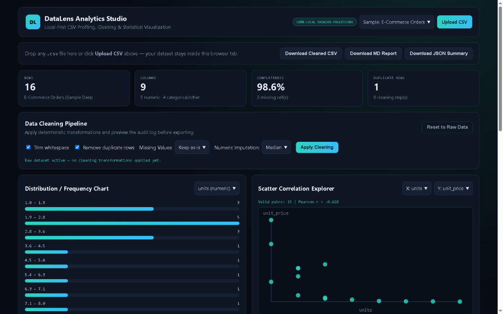

# DataLens Analytics Studio

**DataLens Analytics Studio** is an interactive, local-first CSV analytics platform featuring schema inference, deterministic data cleaning, descriptive statistics with IQR outlier detection, Pearson correlation matrices, SVG visualizations, and downloadable cleaned CSV/Markdown/JSON reports.

---

## Application Preview




## Key Features

- **100% Local Processing**: User-uploaded CSV files are parsed and analyzed inside the browser tab with zero server uploads.
- **RFC-4180 CSV Engine**: Handles quoted fields, embedded commas, BOM headers, and missing-value tokens (`null`, `NA`, `N/A`, empty strings).
- **Interactive Data Cleaning Pipeline**: Trim whitespace, deduplicate rows, drop nulls, or impute missing values (median/mean for numeric, mode for categorical), with a live cleaning log and raw reset.
- **Descriptive Statistics & Correlation Matrix**: Count, missing %, unique count, mean, median, std dev, Q1/Q3, IQR outlier count, and pairwise Pearson `r` heatmap.
- **Interactive Visualizations**: Column distribution histograms/bar charts and X-vs-Y scatter plots.
- **Python CLI Companion**: `python/analyze_csv.py` provides command-line profiling for automated workflows.

---

## Run & Test

```bash
# Run unit tests (Node 18+)
node --test tests/datalens.test.mjs

# Optional Python CLI profiler
python python/analyze_csv.py path/to/data.csv

# Serve locally
npx serve .
```

---

## Limitations

- Sample datasets bundled in the app (`E-Commerce Orders`, `Network Telemetry Logs`, `CS Skills Survey`) are explicitly labeled illustrative sample data.
- Browser-based processing works best for small-to-medium CSV files (up to ~50k rows depending on device RAM).

---

## Author

**Muzammil Shabbir** — [GitHub](https://github.com/Muzammil-s) · [LinkedIn](https://www.linkedin.com/in/muzammil-shabbir-7368a7382)
